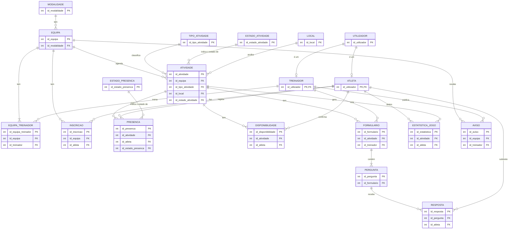

# Team Pulse · BD Report

**Projeto Multidisciplinar · Licenciatura em Engenharia Informática · IADE, Universidade Europeia · 2026/2027, 3.º semestre**
**Unidade curricular:** Bases de Dados (Prof. Miguel Boavida)
**Grupo:** Isabella Almeida (20251497) · Leonor José (20251351) · José Almeida (20250810)

Este documento descreve a base de dados do Team Pulse e os dados de exemplo disponíveis. Corresponde ao capítulo de Base de Dados do relatório do projeto. Os ficheiros referidos estão na pasta `05_Artefactos/Base_Dados/` do repositório:

| Ficheiro | Conteúdo |
|---|---|
| `create.sql` | Cria a base de dados `team_pulse` e as 19 tabelas, com as chaves primárias, as 25 chaves estrangeiras e as 6 restrições de valor único |
| `populate.sql` | Insere os dados de exemplo (fictícios) |
| `queries.sql` | 21 pesquisas que mostram a informação que é possível extrair da BD |

## Índice

1. [Enquadramento](#1-enquadramento)
2. [Modelo Entidade-Relação](#2-modelo-entidade-relação)
3. [Dicionário de Dados](#3-dicionário-de-dados)
4. [Guia de Dados (BD de exemplo)](#4-guia-de-dados-bd-de-exemplo)
5. [Pesquisas (queries.sql)](#5-pesquisas-queriessql)
6. [Instalação](#6-instalação)
7. [Limitações e trabalho futuro](#7-limitações-e-trabalho-futuro)

## 1. Enquadramento

O Team Pulse é uma aplicação móvel para gestão e acompanhamento de equipas desportivas, usada por treinadores e atletas. A base de dados é **relacional** e foi desenvolvida em **MySQL** (requisito RT04/RNF04). É acedida apenas pelo backend Node.js, através dos serviços REST. A aplicação Flutter nunca acede diretamente à BD.

A BD tem de guardar:

- os **utilizadores** e o seu perfil (treinador ou atleta);
- as **equipas**, os seus treinadores e os atletas inscritos;
- as **atividades** (treinos, jogos e torneios), com data, hora, local e código QR;
- as **presenças** registadas por QR Code e a **disponibilidade** confirmada antes de cada atividade;
- os **formulários** pós-atividade, as perguntas e as respostas;
- as **estatísticas** de jogo, incluindo dados GPS;
- os **avisos** do treinador.

O modelo partiu do modelo do domínio da 1.ª entrega (Treinador, Equipa, Atleta, Atividade, Presença, Formulário e Resposta). Foi completado com os requisitos RF01 a RF14 e com o relatório de Interfaces e Usabilidade, de onde vieram a confirmação de disponibilidade, os locais habituais, o estado das atividades e os avisos fixados.

### Principais decisões de modelação

| Decisão | Justificação |
|---|---|
| **Hierarquia** `utilizador` → `treinador` / `atleta` | Os dois perfis partilham o login (nome, email, password), mas têm dados próprios. A chave primária das tabelas filhas é também chave estrangeira para `utilizador` (relação 1 : 0..1). |
| `modalidade` e `local` como **entidades**, não atributos | Garante valores consistentes: o treinador escolhe de uma lista em vez de escrever o texto à mão. A modalidade prepara a app para outras modalidades. O local guarda também as coordenadas GPS. |
| Relações **N:M** resolvidas com tabelas intermédias | `equipa_treinador` (uma equipa pode ter vários treinadores), `inscricao` (o atleta pode mudar de equipa), `presenca`, `disponibilidade`, `resposta` e `estatistica_jogo`. |
| Histórico com `data_inicio`/`data_fim` e `data_entrada`/`data_saida` | Quando alguém muda de equipa, não se apagam linhas: fecha-se o período antigo e abre-se um novo, e as presenças e estatísticas antigas continuam ligadas. |
| Treino, jogo e torneio na **mesma tabela** `atividade` | Partilham quase todos os atributos. A chave estrangeira `id_tipo_atividade` distingue-os. |
| Listas fixas como **entidades**: `tipo_atividade`, `estado_atividade`, `estado_presenca` | Atributo promovido a entidade. A chave estrangeira garante que só se usam valores da lista. As listas mais pequenas (função do treinador, método, resposta, tipo de pergunta, género) ficam em `varchar`/`char` com os valores válidos em comentário e são validadas pelo servidor. |
| Perfil dado pela **tabela onde a pessoa existe** | Não há coluna `tipo` em `utilizador`: uma pessoa é treinador se estiver em `treinador` e atleta se estiver em `atleta`. Assim os dados não se podem contradizer. |
| **Valores únicos só onde evitam duplicados reais** | 6 restrições: email, código QR, presença, disponibilidade e resposta (uma por atleta) e estatística (uma por atleta e jogo). |
| **Validações no servidor** | Regras de datas, listas de valores e valores por omissão são verificadas pelo servidor Node.js antes de gravar (lista V01 a V18 no fim do `create.sql`). |
| `estatistica_jogo` com **colunas fixas** de futebol | Versão simples decidida pelo grupo para esta fase. Ver a secção 7. |
| `codigo_qr` **único** por atividade | A app lê o código no local e o servidor encontra a atividade com uma pesquisa por este campo (RF08). |
| `password_hash` e dados fictícios | Cumprimento do RGPD (Regulamento Geral de Proteção de Dados) e de RNF08: nenhuma password em texto e nenhum dado real. |

## 2. Modelo Entidade-Relação

Notação: pé de galinha (lado "muitos"), traço simples (lado "um"), círculo (pode ser zero). Para facilitar a leitura, o diagrama só mostra as chaves. Os atributos completos estão no Dicionário de Dados.

### Relações e cardinalidades

| Relação | Cardinalidade | Tabela que a implementa | Leitura |
|---|---|---|---|
| Utilizador – Treinador | 1 : 0..1 | `treinador.id_utilizador` | Um utilizador pode ser um treinador. |
| Utilizador – Atleta | 1 : 0..1 | `atleta.id_utilizador` | Um utilizador pode ser um atleta. |
| Modalidade – Equipa | 1 : N | `equipa.id_modalidade` | Uma modalidade tem várias equipas. |
| Equipa – Treinador | N : M | `equipa_treinador` | Uma equipa tem pelo menos um treinador e pode ter vários; um treinador pode estar em várias equipas. |
| Equipa – Atleta | N : M | `inscricao` | Um atleta pode passar por várias equipas ao longo do tempo. |
| Equipa – Atividade | 1 : N | `atividade.id_equipa` | Uma equipa agenda várias atividades. |
| Tipo de atividade – Atividade | 1 : N | `atividade.id_tipo_atividade` | Cada atividade é de um tipo (treino, jogo ou torneio). |
| Estado da atividade – Atividade | 1 : N | `atividade.id_estado_atividade` | Cada atividade tem um estado. |
| Local – Atividade | 1 : N | `atividade.id_local` | Um local acolhe várias atividades. |
| Atleta – Atividade (presença) | N : M | `presenca` | Registo no local, por QR Code ou manual. No máximo uma presença por atleta e atividade. |
| Estado da presença – Presença | 1 : N | `presenca.id_estado_presenca` | Cada registo é presente, ausente ou justificada. |
| Atleta – Atividade (disponibilidade) | N : M | `disponibilidade` | «Vou / Não vou / Talvez», antes da atividade. No máximo uma resposta por atleta e atividade. |
| Atividade – Formulário | 1 : N | `formulario.id_atividade` | Uma atividade pode ter zero ou mais formulários. |
| Treinador – Formulário | 1 : N | `formulario.id_treinador` | Um treinador cria vários formulários. |
| Formulário – Pergunta | 1 : N (mín. 1) | `pergunta.id_formulario` | Um formulário tem pelo menos uma pergunta. |
| Atleta – Pergunta | N : M | `resposta` | Cada atleta responde no máximo uma vez a cada pergunta. |
| Atleta – Atividade (estatísticas) | N : M | `estatistica_jogo` | Uma linha por atleta em cada jogo. |
| Equipa – Aviso / Treinador – Aviso | 1 : N | `aviso` | Um aviso é publicado por um treinador para uma equipa. |

## 3. Dicionário de Dados

Legenda: **PK** chave primária · **FK** chave estrangeira · **UNIQUE** valor que não se pode repetir · **Nulo = Não** significa campo obrigatório (`not null`). As chaves primárias numéricas são `auto_increment`, exceto em `treinador` e `atleta`, onde a chave é o id do utilizador.

Todas as **25 chaves estrangeiras** usam `ON DELETE NO ACTION ON UPDATE NO ACTION`: não é possível apagar uma linha que ainda esteja a ser usada por outra tabela. Para apagar, por exemplo, uma atividade, o servidor apaga primeiro as linhas que dependem dela (presenças, disponibilidades, formulários, estatísticas) e só depois a atividade (validação V18).

#### 3.1 `utilizador`

Todas as pessoas que entram na app. Guarda os dados comuns a treinadores e atletas e serve para o login (RF01). O perfil é dado pela tabela onde a pessoa existe (`treinador` ou `atleta`). Linhas nos dados de exemplo: **31**.

| Coluna | Tipo | Nulo | Chave | Descrição |
|---|---|---|---|---|
| `id_utilizador` | `int` | Não | PK | Identificador do utilizador (automático) |
| `nome` | `varchar(100)` | Não | - | Nome completo |
| `email` | `varchar(150)` | Não | UNIQUE | Email de login |
| `password_hash` | `varchar(255)` | Não | - | Hash bcrypt da password (nunca a password em texto, RGPD) |
| `telefone` | `varchar(20)` | Sim | - | Contacto telefónico |
| `data_registo` | `datetime` | Não | - | Data e hora de criação da conta |

**Valor único:** não pode haver duas contas com o mesmo email.

**Validações no servidor:** V16 (data de registo = agora), V17 (está em `treinador` ou em `atleta`, nunca nas duas).

#### 3.2 `treinador`

Especialização de UTILIZADOR com os dados próprios do treinador. A chave primária é também chave estrangeira para UTILIZADOR. Linhas nos dados de exemplo: **4**.

| Coluna | Tipo | Nulo | Chave | Descrição |
|---|---|---|---|---|
| `id_utilizador` | `int` | Não | PK, FK → `utilizador.id_utilizador` | Identificador do treinador (= id do utilizador) |
| `numero_licenca` | `varchar(30)` | Sim | - | Número da licença de treinador |
| `qualificacao` | `varchar(100)` | Sim | - | Grau ou qualificação (ex.: UEFA B) |

#### 3.3 `atleta`

Especialização de UTILIZADOR com os dados próprios do atleta. Linhas nos dados de exemplo: **27**.

| Coluna | Tipo | Nulo | Chave | Descrição |
|---|---|---|---|---|
| `id_utilizador` | `int` | Não | PK, FK → `utilizador.id_utilizador` | Identificador do atleta (= id do utilizador) |
| `data_nascimento` | `date` | Não | - | Data de nascimento (a idade é calculada) |
| `genero` | `char(1)` | Sim | - | Género: M, F ou O (outro) |
| `altura_cm` | `smallint` | Sim | - | Altura em centímetros |
| `peso_kg` | `decimal(5,2)` | Sim | - | Peso em quilogramas |
| `posicao_preferida` | `varchar(30)` | Sim | - | Posição em campo |

**Validações no servidor:** V05 (género M, F ou O).

#### 3.4 `modalidade`

Lista fixa de modalidades. Nesta versão só tem Futebol, mas permite juntar outras sem alterar a estrutura. Linhas nos dados de exemplo: **1**.

| Coluna | Tipo | Nulo | Chave | Descrição |
|---|---|---|---|---|
| `id_modalidade` | `int` | Não | PK | Identificador da modalidade (automático) |
| `nome` | `varchar(50)` | Não | - | Nome da modalidade |

**Validações no servidor:** V11 (nome sem repetidos).

#### 3.5 `equipa`

Equipas do clube, por escalão e época. Linhas nos dados de exemplo: **3**.

| Coluna | Tipo | Nulo | Chave | Descrição |
|---|---|---|---|---|
| `id_equipa` | `int` | Não | PK | Identificador da equipa (automático) |
| `nome` | `varchar(100)` | Não | - | Nome da equipa |
| `escalao` | `varchar(30)` | Não | - | Escalão (ex.: Sub-17, Seniores) |
| `epoca` | `char(9)` | Não | - | Época desportiva (ex.: 2026/2027) |
| `id_modalidade` | `int` | Não | FK → `modalidade.id_modalidade` | Modalidade da equipa |

**Validações no servidor:** V12 (nome + escalão + época sem repetidos).

#### 3.6 `equipa_treinador`

Tabela intermédia da relação N:M entre EQUIPA e TREINADOR. Uma equipa pode ter vários treinadores e um treinador pode estar em várias equipas. Linhas nos dados de exemplo: **7**.

| Coluna | Tipo | Nulo | Chave | Descrição |
|---|---|---|---|---|
| `id_equipa_treinador` | `int` | Não | PK | Identificador da ligação (automático) |
| `id_equipa` | `int` | Não | FK → `equipa.id_equipa` | Equipa |
| `id_treinador` | `int` | Não | FK → `treinador.id_utilizador` | Treinador |
| `funcao` | `varchar(20)` | Não | - | Função na equipa técnica: principal, adjunto, guarda-redes ou preparador_fisico |
| `data_inicio` | `date` | Não | - | Data em que começou na equipa |
| `data_fim` | `date` | Sim | - | Data em que saiu (NULL = ainda está) |

**Validações no servidor:** V06 (lista de funções), V13 (sem ligações repetidas).

#### 3.7 `inscricao`

Tabela intermédia da relação N:M entre ATLETA e EQUIPA. Guarda o período em que o atleta pertence à equipa, o que permite mudanças de equipa sem perder o histórico. Linhas nos dados de exemplo: **28**.

| Coluna | Tipo | Nulo | Chave | Descrição |
|---|---|---|---|---|
| `id_inscricao` | `int` | Não | PK | Identificador da inscrição (automático) |
| `id_equipa` | `int` | Não | FK → `equipa.id_equipa` | Equipa |
| `id_atleta` | `int` | Não | FK → `atleta.id_utilizador` | Atleta |
| `data_entrada` | `date` | Não | - | Data de entrada na equipa |
| `data_saida` | `date` | Sim | - | Data de saída, que conta como dia inteiro (NULL = ainda está) |
| `numero_camisola` | `tinyint` | Sim | - | Número da camisola (1 a 99) |

**Validações no servidor:** V01 (`data_saida` vazia ou igual/posterior a `data_entrada`), V14 (sem inscrições repetidas).

#### 3.8 `local`

Locais habituais das atividades (campos, ginásio, campos adversários), com coordenadas GPS. Linhas nos dados de exemplo: **5**.

| Coluna | Tipo | Nulo | Chave | Descrição |
|---|---|---|---|---|
| `id_local` | `int` | Não | PK | Identificador do local (automático) |
| `nome` | `varchar(100)` | Não | - | Nome do local |
| `morada` | `varchar(200)` | Sim | - | Morada |
| `latitude` | `decimal(9,6)` | Sim | - | Latitude GPS |
| `longitude` | `decimal(9,6)` | Sim | - | Longitude GPS |

**Validações no servidor:** V11 (nome sem repetidos).

#### 3.9 `tipo_atividade`

Lista fixa dos tipos de atividade (1 treino, 2 jogo, 3 torneio). Passou de atributo a entidade. Linhas nos dados de exemplo: **3**.

| Coluna | Tipo | Nulo | Chave | Descrição |
|---|---|---|---|---|
| `id_tipo_atividade` | `int` | Não | PK | Identificador do tipo (automático) |
| `nome` | `varchar(20)` | Não | - | treino, jogo ou torneio |

#### 3.10 `estado_atividade`

Lista fixa dos estados de uma atividade (1 agendada, 2 alterada, 3 cancelada, 4 realizada). Linhas nos dados de exemplo: **4**.

| Coluna | Tipo | Nulo | Chave | Descrição |
|---|---|---|---|---|
| `id_estado_atividade` | `int` | Não | PK | Identificador do estado (automático) |
| `nome` | `varchar(20)` | Não | - | agendada, alterada, cancelada ou realizada |

#### 3.11 `estado_presenca`

Lista fixa dos resultados de um registo de presença (1 presente, 2 ausente, 3 justificada). Linhas nos dados de exemplo: **3**.

| Coluna | Tipo | Nulo | Chave | Descrição |
|---|---|---|---|---|
| `id_estado_presenca` | `int` | Não | PK | Identificador do estado (automático) |
| `nome` | `varchar(20)` | Não | - | presente, ausente ou justificada |

#### 3.12 `atividade`

Treinos, jogos e torneios de uma equipa. Cada atividade tem um código QR único (RF03 a RF08). Linhas nos dados de exemplo: **11**.

| Coluna | Tipo | Nulo | Chave | Descrição |
|---|---|---|---|---|
| `id_atividade` | `int` | Não | PK | Identificador da atividade (automático) |
| `id_equipa` | `int` | Não | FK → `equipa.id_equipa` | Equipa que realiza a atividade |
| `id_tipo_atividade` | `int` | Não | FK → `tipo_atividade.id_tipo_atividade` | Tipo de atividade |
| `data_hora_inicio` | `datetime` | Não | - | Data e hora de início |
| `data_hora_fim` | `datetime` | Sim | - | Data e hora de fim (se existir, depois do início) |
| `id_local` | `int` | Não | FK → `local.id_local` | Local onde decorre |
| `adversario` | `varchar(100)` | Sim | - | Adversário (só jogos) |
| `observacoes` | `varchar(500)` | Sim | - | Notas ou motivo de alteração/cancelamento |
| `codigo_qr` | `char(12)` | Não | UNIQUE | Código lido pelo QR Code para registar presença |
| `id_estado_atividade` | `int` | Não | FK → `estado_atividade.id_estado_atividade` | Estado da atividade |

**Valor único:** cada atividade tem o seu próprio código QR.

**Validações no servidor:** V02 (`data_hora_fim` vazia ou posterior a `data_hora_inicio`), V16 (estado inicial = agendada), V18 (apagar primeiro as linhas dependentes).

#### 3.13 `presenca`

Registo de presença de um atleta numa atividade, feito no local por QR Code ou manualmente pelo treinador (RF08). Linhas nos dados de exemplo: **69**.

| Coluna | Tipo | Nulo | Chave | Descrição |
|---|---|---|---|---|
| `id_presenca` | `int` | Não | PK | Identificador da presença (automático) |
| `id_atividade` | `int` | Não | FK → `atividade.id_atividade` | Atividade |
| `id_atleta` | `int` | Não | FK → `atleta.id_utilizador` | Atleta |
| `id_estado_presenca` | `int` | Não | FK → `estado_presenca.id_estado_presenca` | Resultado do registo |
| `metodo` | `varchar(10)` | Não | - | Como foi registada: qr ou manual |
| `data_hora_registo` | `datetime` | Sim | - | Momento da leitura do QR |
| `justificacao` | `varchar(255)` | Sim | - | Motivo da falta justificada |

**Combinação única:** (`id_atividade`, `id_atleta`), porque um atleta só tem uma presença por atividade (ex.: ler o QR duas vezes).

**Validações no servidor:** V07 (método qr ou manual).

#### 3.14 `disponibilidade`

Resposta do atleta, antes da atividade, sobre se vai ou não («Vou / Não vou / Talvez»). Se mudar de ideias, a linha é atualizada. Linhas nos dados de exemplo: **12**.

| Coluna | Tipo | Nulo | Chave | Descrição |
|---|---|---|---|---|
| `id_disponibilidade` | `int` | Não | PK | Identificador da resposta (automático) |
| `id_atividade` | `int` | Não | FK → `atividade.id_atividade` | Atividade |
| `id_atleta` | `int` | Não | FK → `atleta.id_utilizador` | Atleta |
| `resposta` | `varchar(10)` | Não | - | Resposta do atleta: vou, nao_vou ou talvez |
| `motivo` | `varchar(255)` | Sim | - | Motivo opcional |
| `data_resposta` | `datetime` | Não | - | Data e hora da última resposta |

**Combinação única:** (`id_atividade`, `id_atleta`), porque um atleta só tem uma resposta por atividade.

**Validações no servidor:** V08 (resposta vou, nao_vou ou talvez), V16 (data = agora).

#### 3.15 `formulario`

Formulário criado por um treinador e associado a uma atividade, por exemplo o pós-treino (RF09). Linhas nos dados de exemplo: **2**.

| Coluna | Tipo | Nulo | Chave | Descrição |
|---|---|---|---|---|
| `id_formulario` | `int` | Não | PK | Identificador do formulário (automático) |
| `id_atividade` | `int` | Não | FK → `atividade.id_atividade` | Atividade a que pertence |
| `id_treinador` | `int` | Não | FK → `treinador.id_utilizador` | Treinador que o criou |
| `titulo` | `varchar(100)` | Não | - | Título |
| `descricao` | `varchar(500)` | Sim | - | Instruções para o atleta |
| `data_criacao` | `datetime` | Não | - | Data e hora de criação |
| `data_limite` | `datetime` | Sim | - | Prazo para responder |

**Validações no servidor:** V16 (data de criação = agora).

#### 3.16 `pergunta`

Perguntas de um formulário, pela ordem em que aparecem. Linhas nos dados de exemplo: **6**.

| Coluna | Tipo | Nulo | Chave | Descrição |
|---|---|---|---|---|
| `id_pergunta` | `int` | Não | PK | Identificador da pergunta (automático) |
| `id_formulario` | `int` | Não | FK → `formulario.id_formulario` | Formulário |
| `ordem` | `tinyint` | Não | - | Posição da pergunta no formulário |
| `texto` | `varchar(255)` | Não | - | Texto da pergunta |
| `tipo_resposta` | `varchar(10)` | Não | - | Tipo de resposta esperada: escala (1 a 5), texto ou sim_nao |

**Validações no servidor:** V09 (tipo de resposta), V15 (ordem sem repetidos no formulário).

#### 3.17 `resposta`

Resposta de um atleta a uma pergunta (RF10, RF11). Linhas nos dados de exemplo: **15**.

| Coluna | Tipo | Nulo | Chave | Descrição |
|---|---|---|---|---|
| `id_resposta` | `int` | Não | PK | Identificador da resposta (automático) |
| `id_pergunta` | `int` | Não | FK → `pergunta.id_pergunta` | Pergunta |
| `id_atleta` | `int` | Não | FK → `atleta.id_utilizador` | Atleta que respondeu |
| `valor_numero` | `tinyint` | Sim | - | Valor da escala (1 a 5) ou sim/não (1/0) |
| `valor_texto` | `varchar(1000)` | Sim | - | Resposta escrita |
| `data_submissao` | `datetime` | Não | - | Data e hora da submissão |

**Combinação única:** (`id_pergunta`, `id_atleta`), porque um atleta responde uma vez a cada pergunta.

**Validações no servidor:** V03 (valor preenchido; escala 1 a 5; sim/não 0 ou 1), V16 (data = agora).

#### 3.18 `estatistica_jogo`

Estatísticas de futebol de um atleta num jogo ou torneio, incluindo dados GPS quando existem (RF12, RF13). Linhas nos dados de exemplo: **20**.

| Coluna | Tipo | Nulo | Chave | Descrição |
|---|---|---|---|---|
| `id_estatistica` | `int` | Não | PK | Identificador (automático) |
| `id_atividade` | `int` | Não | FK → `atividade.id_atividade` | Jogo ou torneio |
| `id_atleta` | `int` | Não | FK → `atleta.id_utilizador` | Atleta |
| `minutos_jogados` | `tinyint` | Não | - | Minutos em campo (0 ou mais) |
| `golos` | `tinyint` | Não | - | Golos marcados |
| `assistencias` | `tinyint` | Não | - | Assistências |
| `cartoes_amarelos` | `tinyint` | Não | - | Cartões amarelos (0 a 2) |
| `cartoes_vermelhos` | `tinyint` | Não | - | Cartões vermelhos (0 ou 1) |
| `distancia_km` | `decimal(4,2)` | Sim | - | Distância percorrida (GPS) |
| `velocidade_max_kmh` | `decimal(4,1)` | Sim | - | Velocidade máxima (GPS) |

**Combinação única:** (`id_atividade`, `id_atleta`), porque uma linha de estatísticas por atleta e jogo.

**Validações no servidor:** V04 (cartões amarelos 0 a 2, vermelho 0 ou 1, valores ≥ 0), V16 (valores começam a 0).

#### 3.19 `aviso`

Avisos e informações do treinador para a equipa (RF14). Linhas nos dados de exemplo: **4**.

| Coluna | Tipo | Nulo | Chave | Descrição |
|---|---|---|---|---|
| `id_aviso` | `int` | Não | PK | Identificador do aviso (automático) |
| `id_equipa` | `int` | Não | FK → `equipa.id_equipa` | Equipa destinatária |
| `id_treinador` | `int` | Não | FK → `treinador.id_utilizador` | Treinador que publicou |
| `titulo` | `varchar(100)` | Não | - | Título |
| `mensagem` | `varchar(1000)` | Não | - | Texto do aviso |
| `fixado` | `char(1)` | Não | - | S = fixado no Início do atleta, N = não |
| `data_publicacao` | `datetime` | Não | - | Data e hora de publicação |

**Validações no servidor:** V10 (fixado S ou N), V16 (data = agora).

#### 3.20 Validações feitas no servidor

Estas regras estão listadas no fim do `create.sql` (V01 a V18). O servidor verifica-as antes de cada `insert` ou `update`.

| Grupo | Regras |
|---|---|
| Datas e valores | V01 saída da inscrição igual ou posterior à entrada · V02 fim da atividade depois do início · V03 resposta preenchida, escala 1 a 5, sim/não 0 ou 1 · V04 cartões (amarelos 0 a 2, vermelho 0 ou 1) e valores ≥ 0 |
| Listas de valores | V05 género · V06 função do treinador · V07 método da presença · V08 resposta de disponibilidade · V09 tipo de resposta · V10 aviso fixado S/N |
| Duplicados de baixo risco | V11 nomes de modalidade e local · V12 equipa (nome, escalão, época) · V13 ligação equipa-treinador · V14 inscrição · V15 ordem das perguntas |
| Valores por omissão | V16 datas de registo, resposta, criação, submissão e publicação = agora; atividade nova = agendada; estatísticas a 0; aviso não fixado |
| Perfil | V17 cada utilizador está em `treinador` ou em `atleta`, nunca nas duas |
| Apagar | V18 apagar primeiro as linhas dependentes (as chaves estrangeiras usam `NO ACTION`) |

## 4. Guia de Dados (BD de exemplo)

O ficheiro `populate.sql` cria uma BD de teste **coerente e com dados fictícios** (RNF08), que simula a utilização da app no caso de estudo, o **Clube Futebol Benfica**, na época 2026/2027.

### 4.1 Período simulado

- As atividades vão de **18/10/2026 a 10/11/2026**.
- O "hoje" da simulação é **06/11/2026 às 12:00**, o dia da 2.ª entrega: as atividades anteriores estão realizadas e têm presenças e estatísticas; as seguintes estão agendadas (ou alteradas/canceladas) e só têm disponibilidades.
- Em `queries.sql` este momento está escrito com `str_to_date('2026.11.06 12:00','%Y.%m.%d %H:%i')`. Na aplicação usa-se `now()`.

### 4.2 Quantidades

| Tabela | Linhas | Notas |
|---|---|---|
| utilizador | 31 | 4 treinadores (ids 1–4) e 27 atletas (ids 5–31) |
| equipa | 3 | Sub-17, Sub-19 e Seniores, todas femininas e de Futebol |
| equipa_treinador | 7 | Inclui um treinador em duas equipas e um que mudou de equipa |
| inscricao | 28 | 27 atletas, uma delas com duas inscrições |
| local | 5 | 3 no Estádio Francisco Lázaro e 2 campos adversários |
| tipo_atividade / estado_atividade / estado_presenca | 3 / 4 / 3 | Listas fixas (inseridas primeiro) |
| atividade | 11 | 6 treinos e 5 jogos; 7 realizadas, 2 agendadas, 1 alterada e 1 cancelada |
| presenca | 69 | 62 presentes, 3 ausentes e 4 justificadas |
| disponibilidade | 12 | 8 «vou», 3 «não vou» e 1 «talvez» |
| formulario / pergunta / resposta | 2 / 6 / 15 | Pós-treino dos Sub-17 e das Seniores, treino de 03/11 |
| estatistica_jogo | 20 | GPS só nas Seniores (coletes GPS) |
| aviso | 4 | 2 fixados |

### 4.3 Estrutura das equipas

| Equipa | Treinadores atuais | Atletas (ids) |
|---|---|---|
| CF Benfica Sub-17 Femininos | Rui Matos (principal), Paulo Ferreira (adjunto) | 5–10 |
| CF Benfica Sub-19 Femininos | Paulo Ferreira (principal), Hugo Teixeira (preparador físico) | 12–19 e 11 |
| CF Benfica Seniores Femininos | Marta Lopes (principal), Hugo Teixeira (preparador físico) | 20–31 |

Rui Matos (treinador) corresponde à **persona** do treinador do relatório de Interfaces e Usabilidade.

### 4.4 Situações reais simuladas

Os dados incluem casos pensados para testar a app e as queries:

| Situação | Onde está nos dados |
|---|---|
| Atleta que muda de equipa | Sofia Espanhol (id 11): Sub-17 até 30/09, Sub-19 desde 01/10 |
| Treinador que muda de equipa | Hugo Teixeira: preparador físico dos Sub-17 até 30/09, das Seniores desde 01/10 |
| Atletas com assiduidade baixa | Ana Machado (0%), Ana Carvalho, Constança Rodrigues e Matilde Silva (50%) (query Q10) |
| Atividade cancelada | Sub-19, 04/11 (chuva) |
| Atividade alterada | Seniores, 10/11 (passa para o Campo 2) |
| Disse «vou» e faltou | Constança Rodrigues, treino dos Sub-17 de 03/11 (query Q20) |
| Formulários por responder | Atletas presentes no treino de 03/11 que ainda não responderam (query Q16) |
| Presenças manuais | Nos jogos o treinador regista as presenças à mão; nos treinos usa-se o QR |
| Dados opcionais por preencher | Alguns atletas sem altura e peso, alguns utilizadores sem telefone |

### 4.5 Contas de teste

Todos os utilizadores têm a password **`TeamPulse#2026`**, guardada com bcrypt. Os emails seguem o formato `nome.apelido@teampulse.test` (o domínio `.test` é reservado e não existe).

| Perfil | Email | Para testar |
|---|---|---|
| Treinador | `rui.matos@teampulse.test` | Sub-17: presenças, formulários, avisos |
| Treinador | `paulo.ferreira@teampulse.test` | Treinador em duas equipas |
| Atleta | `lara.natividade@teampulse.test` | Atleta das Seniores (query Q08) |
| Atleta | `sofia.espanhol@teampulse.test` | Atleta que mudou de equipa |

## 5. Pesquisas (queries.sql)

O ficheiro tem **21 pesquisas**, organizadas em 4 grupos de complexidade crescente. Cada pesquisa tem um comentário com a pergunta a que responde; o requisito que apoia está na tabela abaixo. Os tipos e estados vêm das tabelas `tipo_atividade`, `estado_atividade` e `estado_presenca` através de `inner join`; a "próxima atividade" e o "formulário mais recente" são escolhidos pela data, não pelo id; a assiduidade conta todas as atividades realizadas durante o período de inscrição do atleta (a data de saída conta como dia inteiro).

| # | Pergunta | Técnicas SQL | Requisito |
|---|---|---|---|
| **A** | **Consultas simples e funções de linha** | | |
| Q01 | Próximas atividades dos Sub-17 nos próximos 7 dias (sem as canceladas) | `between`, `str_to_date`, `+ interval`, `date_format`, `timestampdiff`, `coalesce` | RF06, RF07 |
| Q02 | Plantel atual das Seniores com idade calculada | `timestampdiff`, `ifnull`, `concat`, `is null` | RF02 |
| Q03 | Atividades canceladas ou alteradas e motivo | `in`, `upper`, `date_format` | RF05 |
| **B** | **Junções** | | |
| Q04 | Validação de um código QR lido | `inner join`, `case` com subconsulta `in` | RF08 |
| Q05 | Lista de presenças do último treino (pela data), incluindo «por registar» | `inner join`, subconsultas no `select` com `coalesce`, `max` | RF08 |
| Q06 | Equipa técnica atual de cada equipa | `inner join` de 4 tabelas (N:M) | RF02 |
| Q07 | Respostas ao formulário mais recente (pela data de criação) | `inner join`, `case`, subconsulta com `max` | RF11 |
| Q08 | Avisos visíveis para uma atleta (fixados primeiro) | `inner join`, `case`, ordenação por várias colunas | RF14 |
| **C** | **Funções de grupo** | | |
| Q09 | Assiduidade por equipa e tipo de atividade | `group by` de 2 colunas, `sum(case ...)`, `count` | RF12 |
| Q10 | Atletas com assiduidade abaixo de 75% | `inscricao` × `atividade` por período, `sum(case ... in (subconsulta))`, `having` | RF12 |
| Q11 | Melhores marcadores e golos por 90 minutos (jogos realizados, minutos > 0) | `group by`, `having`, `sum` | RF12 |
| Q12 | Distância e velocidade GPS por atleta | `avg`, `max`, `count(coluna)`, `having` | RF12, RF13 |
| Q13 | Esforço médio por treino e número de respostas | `count`, `avg`, `min`, `max` | RF11 |
| Q14 | Percentagem de presenças por QR por mês | `group by` sobre `date_format`, `sum(case ...)` | RF08 |
| Q15 | Disponibilidade para a próxima atividade de cada equipa (pela data) | subconsultas no `select`, `not in`, subconsulta correlacionada com `min` | RF05 |
| **D** | **Subconsultas** | | |
| Q16 | Presentes que ainda não responderam ao formulário mais recente | `not in`, subconsulta correlacionada com `max` | RF10 |
| Q17 | Atletas acima da média da própria equipa | Tabelas derivadas, subconsulta **correlacionada** | RF12 |
| Q18 | Percurso dos atletas que mudaram de equipa | `in` + `having count(distinct)` | RF02 |
| Q19 | Jogo realizado com mais golos de cada equipa | Tabela derivada, subconsulta correlacionada com `max` | RF12 |
| Q20 | Disse «vou» e ficou registado como «ausente» | `inner join` entre disponibilidade e presença | RF12 |
| Q21 | Utilização dos locais (atividades e jogos) | Subconsultas correlacionadas no `select` | RF04 |

## 6. Instalação

1. Abrir o **MySQL Workbench** e ligar ao servidor local.
2. *File → Open SQL Script* → `create.sql` → executar (⚡). É criada a base `team_pulse`. **Atenção:** o script começa com `drop database if exists team_pulse`, por isso apaga uma versão anterior.
3. Abrir `populate.sql` → executar (⚡).
4. Abrir `queries.sql` → executar as linhas `set names` e `use` do início e depois uma pesquisa de cada vez (selecionar o texto da pesquisa e carregar em *Ctrl+Shift+Enter*).

Os três scripts foram testados no MySQL do MAMP: o create.sql e o populate.sql correm sem erros, e as 21 pesquisas devolvem resultados.

## 7. Limitações e trabalho futuro

- **Estatísticas só de futebol:** `estatistica_jogo` tem colunas fixas. Para outras modalidades, a evolução prevista é substituí-la por uma tabela de métricas (nome, unidade, modalidade) e outra de valores por atleta e atividade.
- **Jogos na app:** a app Flutter regista acontecimentos do jogo (golos, assistências, substituições, cartões com o minuto) e os titulares; a BD guarda os totais por atleta em `estatistica_jogo`. A forma de juntar os dois modelos ainda está por decidir.
- **Plantéis pequenos:** os dados de exemplo têm 6 a 12 atletas por equipa, o que nem sempre chega para 11 titulares. Fica para a mesma decisão.
- **Validações no servidor:** como a BD não usa `CHECK` nem `ENUM`, as regras V01 a V18 têm de ser implementadas no servidor; se alguém inserir dados diretamente na BD, estas regras não são verificadas.
- **Notificações:** a app vai enviar notificações sobre alterações e formulários pendentes. Nesta versão são calculadas a partir de `atividade.id_estado_atividade`, `aviso` e `formulario`. Se for preciso guardar o histórico de notificações enviadas, junta-se uma tabela própria.
- **Código QR fixo:** o código não expira. Se for preciso impedir registos à distância, pode juntar-se uma validade ou validar a localização GPS do telemóvel com as coordenadas de `local`.
- **Dados de exemplo:** são fictícios e gerados de forma controlada. Não representam o desempenho real de nenhum atleta.
